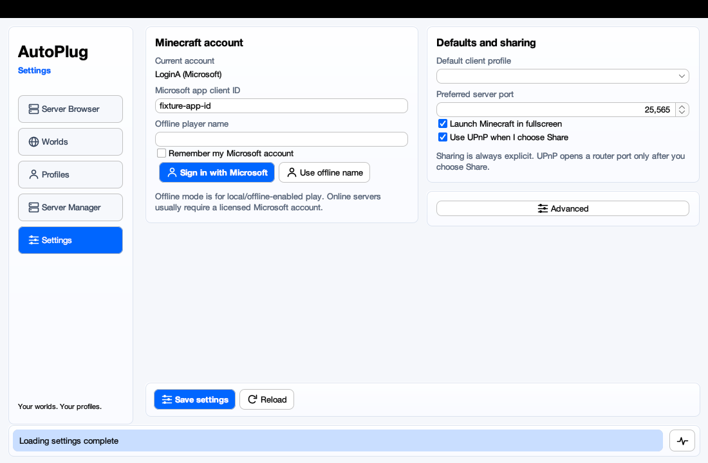
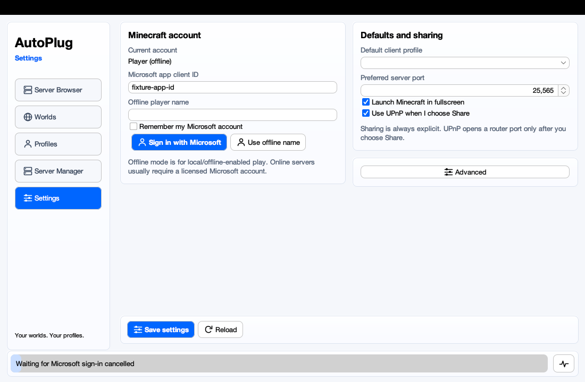
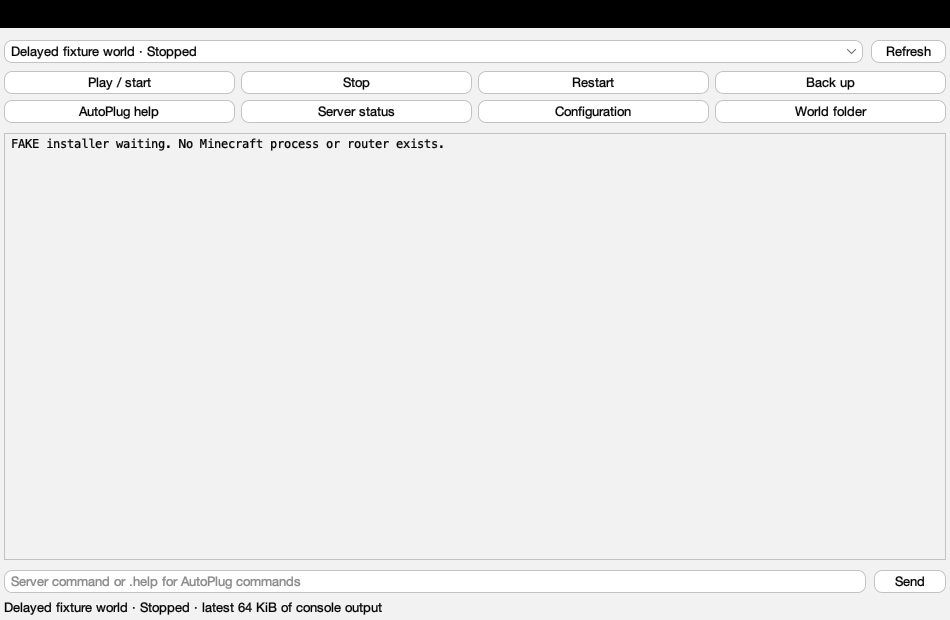
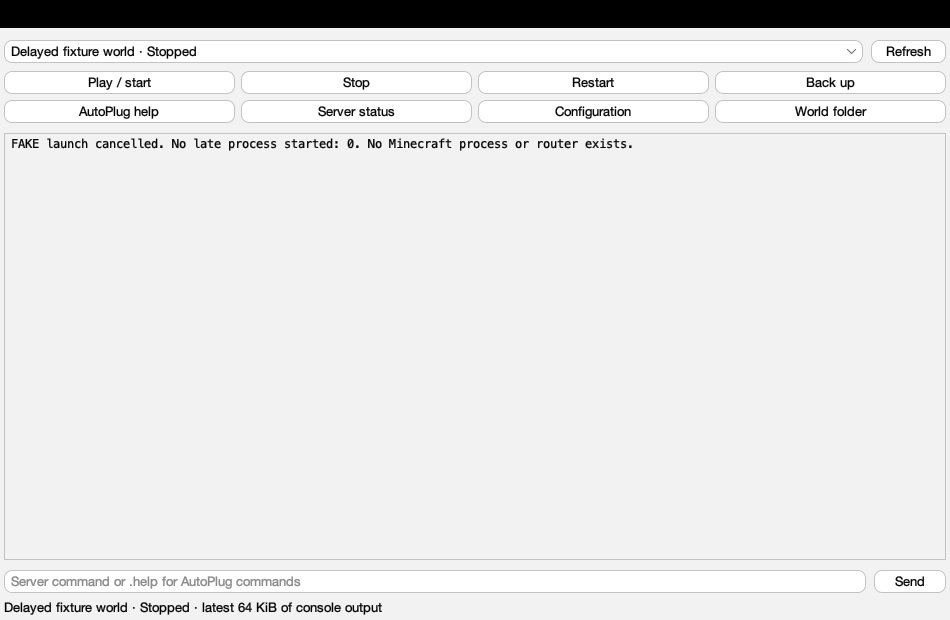
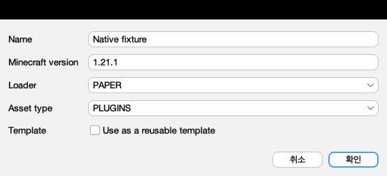

# Derived authentication, world startup and profile validation fixes

This derived contribution builds on AntonSelin's PR #297, commit
`fdc3c95d3ed6454874e0a9bfdb5e474366869ca6`, and the repository's MIT license.
ithyme7's PR #298, commit `cb16ea15d4aeb2e9f35ec3f019bc449c204390dd`, was
reviewed for comparable authentication and world cancellation designs. Its
implementation was not copied into this delta. The inherited launcher,
profiles, dashboard, world orchestration and previews remain the original
contributors' work.

AI coding agents wrote and directly source-reviewed this delta and ran its
automated and native Swing fixture checks. No separate human technical review,
human gameplay test, real Microsoft sign-in or real router validation is claimed.
Issue #296 delegates the final live authenticated join to maintainers. Passing
these checks does not establish maintainer acceptance, merge or bounty payment.

## Behavior

- A cancelled or superseded Microsoft sign-in cannot replace the current
  account or persisted choice. See [authentication-lifecycle.md](authentication-lifecycle.md).
- `WorldService` registers a pending owner before installation. Stop and service
  close invalidate and interrupt it even before a running session exists.
  Late installer, readiness, process-factory and client results are checked;
  owned processes and locks are cleaned up rather than publishing a late session.
  A cancelled but unfinished collaborator retains its ownership until it returns.
- Profiles validate type/loader compatibility at create, save and read. A
  PLUGINS collection requires a plugin loader; vanilla server collections use
  MODS_SERVER. Client/server mod collections reject plugin loaders. Create and
  clone dialogs filter choices using the same rule. Previously saved invalid
  metadata produces an explicit error; it is not rewritten or silently discarded.
- The offline client fixture compares filesystem identity rather than literal
  working-directory spelling, accommodating macOS `/var` versus `/private/var`
  while still rejecting a different launch directory.

## Relevant new regressions

`LauncherAuthenticationRaceTest`, `DashboardAuthenticationLifecycleTest`,
`WorldStartupCancellationTest`, `ProfileLoaderCompatibilityTest`,
`DashboardProfileCompatibilityTest`, and `ManagedWorldStartupNativeTest` use
fake auth/installers or original harmless process fixtures. Delayed collaborators
intentionally ignore interruption, so tests require invalidation as well as an
interrupt signal. The native profile dialog persists through actual ProfileStore;
the native Stop buttons call actual WorldService.

Synthetic EULA flags belong only to temporary test metadata. Real Minecraft
servers are never launched by these tests. Production EULA guards remain in
place. The packaged CLI smoke refuses unaccepted-world launch before installation;
the packaged-wrapper smoke starts original tiny JVM servers without an eula.txt.

Native tests must run separately with `-Djava.awt.headless=false`; a headless
skip is not a native test pass. Native peer paint images and offscreen previews
show component layout; process/account assertions establish fixture behavior.

Existing selected suites cover profile isolation and migration, provider errors,
disable summaries, actual MineStat/NBT responses, manifests and loader metadata,
offline client JVM arguments/cache, UPnP local SOAP/forwarder ownership, managed
child cleanup, default utility staging, chooser/history/fullscreen arguments,
progress and UI layout. External-network/SteamCMD/download suites are not included
in the deterministic selection. Runtime compile targets remain Java 9, with the
inherited legacy world helper targeting Java 8.

## Remaining limits

In-flight non-cooperative HTTP/installer operations may finish before the caller
can release their resources, but cancellation rejects their late launch results.
Long service monitors in inherited launcher/settings code and server readiness
version verification remain review areas outside this delta. This is not a general
launch parallelism rewrite or a promise of immediate cancellation of every IO call.

Game/utility-pack play, true save load/preservation in Minecraft, real loader
processors against game artifacts, real Microsoft entitlement/join and router/WAN
reachability still require appropriate acceptance testing. Real publisher JSON
and metadata-only production parser checks do not execute game or loader code.

## Executed validation

The AI agent executed these checks on macOS with checksum-verified JDK 21 and
Maven 3.9.11, using isolated data/home directories and Maven dependencies:

- 210 selected deterministic test cases passed, zero failures/errors/skips.
- 6 native Swing cases passed separately, zero failures/errors/skips.
- Offline Maven packaging passed with Java 9 and legacy-helper Java 8 targets.
- The 12 new world/profile regressions against unmodified #297 behavior produced
  10 assertion failures, one blocked-close timeout, and one passing positive control;
  all 12 pass with this delta. The earlier auth baseline fails nine of ten, with
  the current-login control passing. Original auth/UI coverage remains included.
- The actual packaged CLI passed invalid-profile guards, version periods,
  empty-profile clone/migration, offline selection, world creation and refusal
  to launch an unaccepted world before installation.
- The inherited `ManagedWorldPackagedSmoke` started two actual packaged AutoPlug
  wrappers around original tiny JVM servers, verifying command isolation, restart,
  graceful stop and wrapper exit after the raw server stopped. No game server
  binary or real EULA was involved. Native/wrapper checks blocked non-loopback
  traffic using a supplemental OS policy and IPv4 loopback configuration.
- Read-only public Mojang/Fabric/Modrinth JSON probes returned HTTP 200;
  published Mojang metadata SHA1 values matched. A production metadata-only
  parser read 1.21.1 and 26.3 as Java 21 and 25. No game/mod/loader/runtime
  artifact was installed or executed by these metadata probes.

[Per-suite results](verification/derived-results.json) omit raw Maven environment
properties, local paths and credentials. The exact deterministic selector is in
[derived-test-selector.txt](verification/derived-test-selector.txt).
No inherited author test counts are added to these 216 executed cases.

After preparing the existing Maven dependencies in a reviewed environment:

```sh
selector=$(cat docs/verification/derived-test-selector.txt)
mvn -o -Djava.awt.headless=true "-Dtest=$selector" package
mvn -o -Djava.awt.headless=false \
  -Dtest=DashboardAuthenticationLifecycleTest,DashboardDisplayableTest,DashboardProfileCompatibilityTest,ManagedWorldStartupNativeTest test
```

The native suite requires a desktop; a headless skip must not be reported as a
pass. For packaged offline-world reproduction, run the inherited smoke helper
with the packaged JAR and test classes after reviewing its source:

```sh
fixture_root=$(mktemp -d)
JAVA_TOOL_OPTIONS="-Duser.home=$fixture_root/home -Djava.net.preferIPv4Stack=true" \
  java -cp target/test-classes:target/AutoPlug-Client.jar \
  com.osiris.autoplug.client.worlds.ManagedWorldPackagedSmoke "$PWD" "$fixture_root/worlds"
```

Do not use raw local Maven logs as public evidence: they contain execution paths
and environment properties. No payout address, credentials, game JAR or local
user files are part of this contribution. Full local logs remain available for
private verification; the public summary only reports checks actually executed.

## Native fixture images

These are component paints of live native-peer windows with synthetic data,
not human screenshots or gameplay evidence. The auth baseline intentionally
shows the stale-login defect after closing the dialog.







## Submission and acceptance

This derived draft requests maintainer feedback and final acceptance validation
for [#296](https://github.com/Osiris-Team/AutoPlug-Client/issues/296), including
[the maintainer's final authenticated join arrangement](https://github.com/Osiris-Team/AutoPlug-Client/issues/296#issuecomment-5972762400).
It does not claim all gameplay/UX acceptance is complete or a bounty is earned.
The original author remains active; this is not an abandonment claim. Current
bounty terms and the original contributor's seven-calendar-day grace period,
when initiated by a maintainer for a merge-ready derived PR, remain applicable.
Draft submission alone is not claimed to start that period. No payout information
or profile edit is requested or included.
